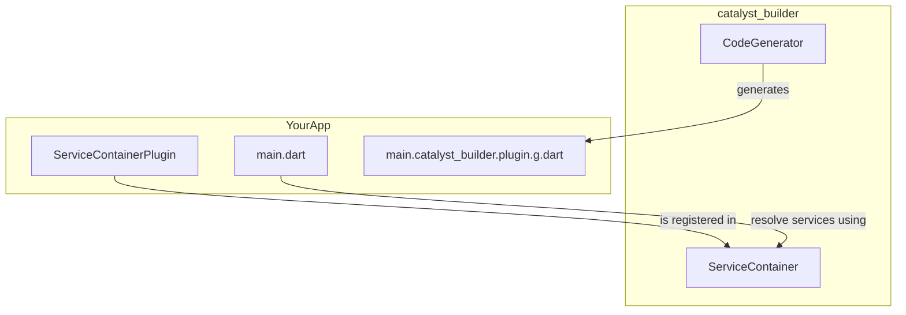

After you installed the necessary packages you can start setting up the project.

Before we start you should understand the high level architecture of catalyst_builder

As you can see, there is a generated file in the graph.
