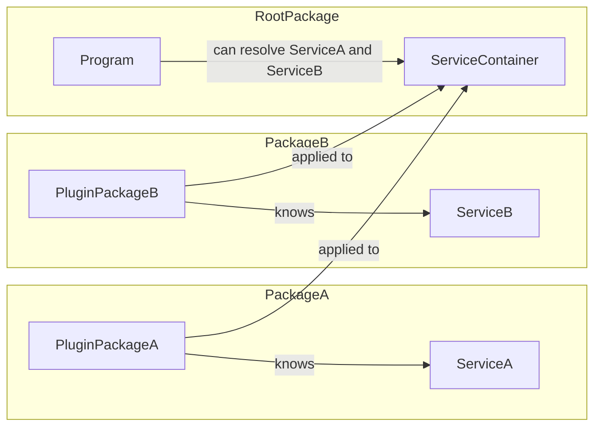

The architecture of `catalyst_builder` needs a makeover since the `build_runner` changed a lot under the hood in the
last years.
I tried in v4.0.0 to create a solution using the custom cache, but it does not work as intended in bigger production
projects.

The old mechanism went through all the packages you depend on and searched for annotations like `@Service`. This was
getting really slow after changing `auto_apply: all_packages`. On top of that the change detection for rebuilds was not
reliable

The new architectural approach is a plugin based system. Every package that provide services will now emit a
`ServiceContainerPlugin` that can be applied to any service container.



## Upgrade guidance

### Contracts package

- Add `catalyst_builder_contracts` to `dependencies`.

### Annotations

#### Location
Annotations has been moved to the [`catalyst_builder_contracts`](https://pub.dev/packages/catalyst_builder_contracts) 
package. To fix your code, simply replace all imports
```diff
- import 'package:catalyst_builder/catalyst_builder.dart';
+ import 'package:catalyst_builder_contracts/catalyst_builder_contracts.dart'; 
```

#### GenerateServiceProvider
The `GenerateServiceProvider` annotation was removed. Use `GenerateServiceContainerPlugin` instead.

Include the generated `*.catalyst_builder.plugin.g.dart` file instead of `*.catalyst_builder.g.dart`.

Update the initialization of your container.
```diff
- var provider = DefaultServiceProvider();
+ var container = ServiceContainer();
+ container.useNameOfThePlugin();
```

### Services from dependencies

As described above, services from dependencies are no longer resolved automatically.

If you're a plugin developer or have a monorepo then add this to the entrypoint file of the package:

```dart
@GenerateServiceContainerPlugin(
  pluginClassName: 'NameOfYourPlugin',
)
void _() {} // ignore: unused_element
```

After that, run `dart run build_runner build` to generate a `.catalyst_builder.plugin.g.dart` file.

Add an export of file to your entrypoint file:

```dart
export 'my_generated_plugin.catalyst_builder.plugin.g.dart'; // new

@GenerateServiceContainerPlugin(
  pluginClassName: 'NameOfYourPlugin',
)
void _() {} // ignore: unused_element
```

Don't forget to track this file in VCS and publish it to your package.

If you're consuming a third party package the other package must use v5+ of catalyst_builder and export the plugin as
described above.
Then you're able to apply the plugin using the generated extension method:

```dart
void main() {
  var container = ServiceContainer()
    ..useNameOfYourPlugin();

  container.boot();
}
```

### Mono repos with pub workspaces

If you're using a monorepo you need to create a plugin for each package. (Described above)

To watch for file changes and regenerate the plugins for all packages you can use this small package:
[pub.dev/workspace_scripts](https://pub.dev/packages/workspace_scripts)

### Cache configuration

Remove the cache configuration from pubspec.yaml

```diff
- catalyst_builder:
-  cacheDir: '.cache/catalyst_builder'
```
